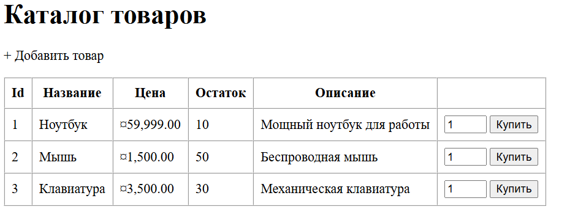
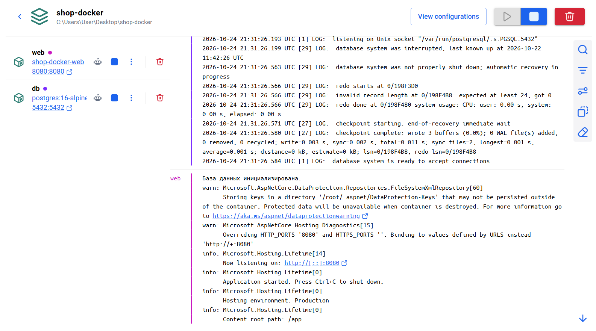
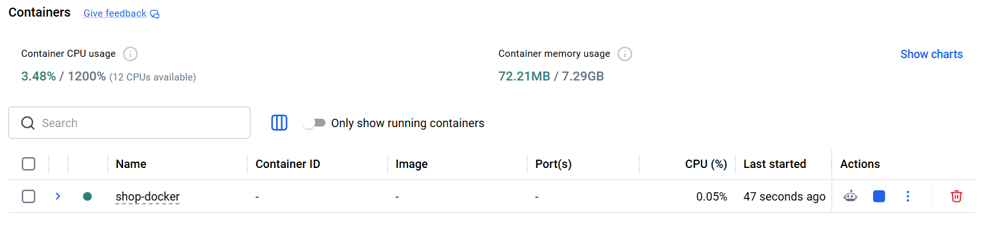

# Практическая работа: ASP.NET Core + PostgreSQL в Docker

Веб-приложение (каталог товаров) на C# с использованием ADO.NET (Npgsql) и базы данных PostgreSQL. Всё запускается в Docker.

### Скриншоты работы
**Главная страница сайта:**

**Логи Docker (инициализация БД):**

**Вкладка Containers в Docker Desktop:**

