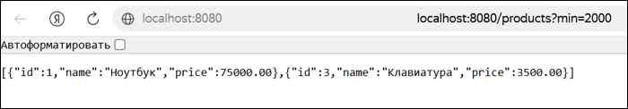
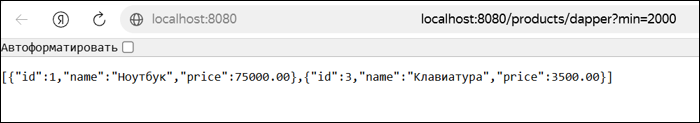
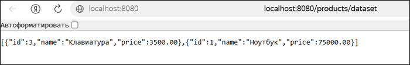
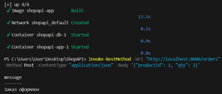

# Билет №1 - ADO.NET

Учебная практическая работа по разработке REST API на **ASP.NET Core Minimal API** с подключением к **PostgreSQL**.

В проекте реализованы различные способы работы с базой данных: **ADO.NET (Npgsql)**, **Dapper** и **DataSet**.

## Технологии

- C# / .NET 8
- ASP.NET Core Minimal API
- PostgreSQL
- ADO.NET (Npgsql)
- Dapper
- DataSet
- Docker / Docker Compose

## Реализованные запросы

| Метод | Эндпоинт | Описание |
|---|---|---|
| GET | `/products?min=2000` | Получение товаров через ADO.NET с фильтрацией по цене |
| GET | `/products/dapper?min=2000` | Получение товаров через Dapper |
| GET | `/products/dataset` | Получение товаров с использованием DataSet |
| POST | `/orders` | Создание заказа |

## Результаты тестирования

### 1. Получение товаров через ADO.NET

Запрос `GET /products?min=2000`.



### 2. Получение товаров через Dapper

Запрос `GET /products/dapper?min=2000`.



### 3. Получение товаров через DataSet

Запрос `GET /products/dataset`.



### 4. Создание заказа

Запрос `POST /orders`.



## Структура проекта

```text
03. ADO.NET Ticket 1 Preparation/
├── ShopAPI/
│   ├── Properties/
│   ├── Program.cs
│   ├── ShopAPI.csproj
│   ├── Dockerfile
│   ├── docker-compose.yml
│   ├── init.sql
│   ├── appsettings.json
│   └── README.md
├── screenshot/
│   ├── 1_products_ado.png
│   ├── 2_products_dapper.png
│   ├── 3_products_dataset.png
│   └── 4_orders_post.png
└── README.md
```

## Итог

В ходе практической работы реализовано REST API для взаимодействия с PostgreSQL. Отработаны получение данных через ADO.NET, Dapper и DataSet, а также создание заказов.

Приложение проверено с использованием Docker.
