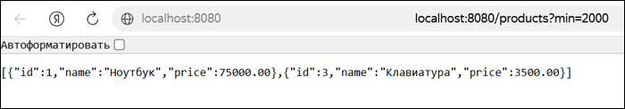
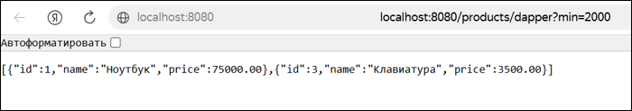
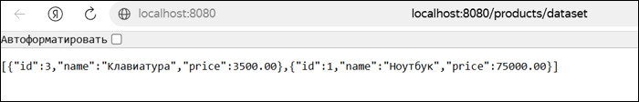
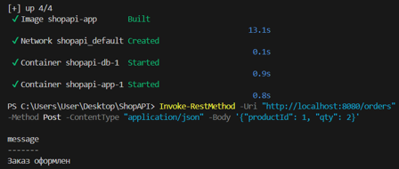

# Билет №1 - ADO.NET

Учебная практическая работа по разработке REST API на **ASP.NET Core Minimal API** с подключением к **PostgreSQL**.

В проекте реализованы различные способы работы с базой данных: **ADO.NET (Npgsql)**, **Dapper** и **DataSet**.

## Технологии

- C# / .NET 8
- ASP.NET Core Minimal API
- PostgreSQL
- ADO.NET (Npgsql)
- Dapper
- DataSet
- Docker / Docker Compose

## Реализованные запросы

| Метод | Эндпоинт | Описание |
|---|---|---|
| GET | `/products?min=2000` | Получение товаров через ADO.NET с фильтрацией по цене |
| GET | `/products/dapper?min=2000` | Получение товаров через Dapper |
| GET | `/products/dataset` | Получение товаров с использованием DataSet |
| POST | `/orders` | Создание заказа в транзакции |
| GET | `/products/stats` | Количество товаров и суммарная стоимость (доп. задача 1.1) |
| PUT | `/products/{id}/price` | Изменение цены товара с проверкой существования (доп. задача 1.2) |

## Дополнительные задачи

### 1.1. Статистика товаров

`GET /products/stats` выполняет один SQL-запрос с `COUNT(*)` и `SUM(price)`. Через `ExecuteReaderAsync()` считываются **обе колонки** результата; `COALESCE` возвращает ноль при пустой таблице.

Пример ожидаемого ответа для исходных трёх товаров:

```json
{
  "count": 3,
  "totalPrice": 80000.00
}
```

### 1.2. Изменение цены товара

`PUT /products/1/price` с телом запроса:

```json
{
  "price": 80000.00
}
```

`ExecuteNonQueryAsync()` возвращает число изменённых строк. Если `0`, API отдаёт **404 Not Found**; если товар найден, возвращает **200 OK**. Отрицательная цена отклоняется с **400 Bad Request**.

Примеры ответов указаны по логике кода; дополнительные эндпоинты ещё не проверялись реальным запуском.

## Результаты тестирования исходного билета

### 1. Получение товаров через ADO.NET

Запрос `GET /products?min=2000`.



### 2. Получение товаров через Dapper

Запрос `GET /products/dapper?min=2000`.



### 3. Получение товаров через DataSet

Запрос `GET /products/dataset`.



### 4. Создание заказа

Запрос `POST /orders`.



## Структура проекта

```text
03. ADO.NET Ticket 1 Preparation/
├── ShopAPI/
│   ├── Properties/
│   ├── Program.cs
│   ├── ShopAPI.csproj
│   ├── Dockerfile
│   ├── docker-compose.yml
│   ├── init.sql
│   ├── appsettings.json
│   └── README.md
├── screenshot/
│   ├── 1_products_ado.png
│   ├── 2_products_dapper.png
│   ├── 3_products_dataset.png
│   └── 4_orders_post.png
└── README.md
```

## Итог

Реализовано REST API для работы с PostgreSQL через ADO.NET, Dapper и DataSet, с оформлением заказа в транзакции. Дополнительно добавлены статистика каталога и обновление цены товара с обработкой случая, когда товар отсутствует.

Исходная часть работы ранее проверена с использованием Docker. Дополнительные задачи добавлены без запуска приложения.
