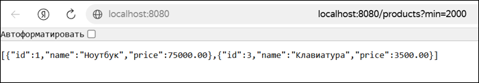
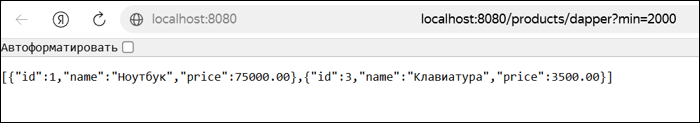
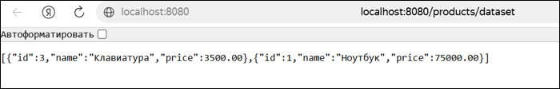
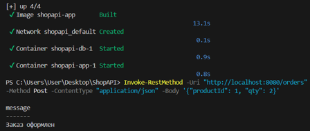

# Билет №1 — Интернет-магазин: каталог товаров

Учебное REST API на **ASP.NET Core Minimal API (.NET 8)** с использованием **PostgreSQL**, **ADO.NET (Npgsql)** и **Dapper**. Работа включает основной билет и две дополнительные задачи.

## 🛠 Технологии

- C# / .NET 8, ASP.NET Core Minimal API
- PostgreSQL 16, Npgsql (ADO.NET)
- Dapper, DataSet / DataAdapter / DataTable
- Docker, Docker Compose

## Реализованные эндпоинты

| Метод | Адрес | Что делает |
|---|---|---|
| GET | `/products?min=2000` | Выбирает товары по минимальной цене через ADO.NET и параметры SQL |
| GET | `/products/dapper?min=2000` | Выбирает те же товары через Dapper |
| GET | `/products/dataset` | Формирует отчёт через DataSet и `DataTable.Select()` |
| POST | `/orders` | Создаёт заказ в транзакции |
| GET | `/products/stats` | **Доп. задача 1.1:** количество товаров и суммарная стоимость |
| PUT | `/products/{id}/price` | **Доп. задача 1.2:** изменение цены товара с проверкой существования |

## Дополнительные задачи

### 1.1. Статистика каталога

`GET /products/stats` выполняет один запрос с `COUNT(*)` и `SUM(price)`. Метод `ExecuteReaderAsync()` читает обе колонки; `COALESCE` заменяет `NULL` на ноль при пустой таблице.

Пример ожидаемого ответа на исходных данных:

```json
{
  "count": 3,
  "totalPrice": 80000.00
}
```

### 1.2. Изменение цены

`PUT /products/1/price`

Тело запроса:

```json
{
  "price": 80000.00
}
```

После `UPDATE` метод `ExecuteNonQueryAsync()` возвращает количество затронутых строк: **0 — `404 Not Found`**, **1 — `200 OK`**. Отрицательная цена возвращает `400 Bad Request`.

> Дополнительные эндпоинты добавлены в код, но пока не проверены запуском. Примеры ответов приведены по ожидаемой логике.

## 📸 Скриншоты исходной работы

### 1. Получение товаров через ADO.NET



### 2. Получение товаров через Dapper



### 3. Отчёт через DataSet



### 4. Оформление заказа



## Запуск

Для запуска необходимы Docker и Docker Compose. Из папки `ShopAPI`:

```bash
docker compose up --build
```

База данных и тестовые товары создаются SQL-скриптом `init.sql`. **Для загрузки изменений в GitHub запуск не требуется.**
